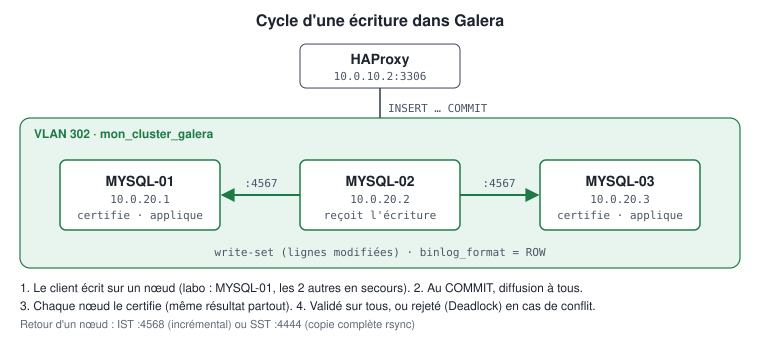

# MO-1 — Monter un cluster MariaDB Galera à 3 nœuds

> 📁 Document de mon dossier E6 (BTS SIO SISR), tel que je l'ai rédigé pendant la mise en place de mon laboratoire. Version du 10/10/2026. Les adresses sont celles de mon laboratoire : adapte-les au tien.

Concepts, installation, configuration de chaque nœud, amorçage, validation et reprise.

> 🔐 Aucun mot de passe ni clé dans ce document : les secrets sont remplacés par des marque-places.

## Sommaire

- Galera — Concepts
- Galera — Installation
- bdd-01 — 10.0.20.1
- bdd-02 — 10.0.20.2
- bdd-03 — 10.0.20.3
- Galera — Bootstrap
- Galera — Validation
- Galera — Reprise après panne

---

## Galera — Concepts

### Ce que fait Galera

**MariaDB Galera Cluster** transforme plusieurs serveurs MariaDB en un cluster **multi-maître synchrone** :

- **multi-maître** : chaque nœud accepte lectures **et** écritures ;
- **synchrone** (« virtuellement synchrone ») : au `COMMIT`, la transaction est diffusée à tous les nœuds et **certifiée** avant d'être confirmée au client. Une transaction confirmée ne peut pas être perdue par la panne d'un nœud ;
- **automatique** : un nœud qui revient se resynchronise seul (IST ou SST).

Comparaison avec la réplication classique MariaDB (primaire / réplique asynchrone) :

| Critère | Réplication asynchrone | Galera |
|---------|------------------------|--------|
| Écritures | Primaire seul | Tous les nœuds |
| Perte possible si le primaire tombe | Oui (transactions non encore répliquées) | Non |
| Bascule | Manuelle ou outil externe | Implicite (les autres nœuds sont déjà à jour) |
| Latence d'écriture | Faible | + 1 aller-retour réseau entre nœuds |
| Moteur | Tous | **InnoDB uniquement** |

### Cycle d'une écriture

<p align="center"></p>

1. Le client écrit sur bdd-02 (choisi par HAProxy).
2. Au `COMMIT`, bdd-02 diffuse le *write-set* (lignes modifiées) aux autres nœuds (port 4567).
3. Chaque nœud **certifie** le write-set : conflit avec une transaction concurrente ? Le résultat est déterministe et identique partout.
4. Certifiée : la transaction est validée sur bdd-02 et appliquée sur bdd-01 et bdd-03.
5. Conflit : le client reçoit une erreur `Deadlock found` et doit rejouer la transaction.

### Paramètres de configuration

| Paramètre | Valeur | Rôle |
|-----------|--------|------|
| `wsrep_on` | `ON` | Active la réplication Galera |
| `wsrep_provider` | `/usr/lib/galera/libgalera_smm.so` | Bibliothèque Galera (paquet `galera-4`) |
| `wsrep_cluster_name` | `mon_cluster_galera` | Nom du cluster ; **identique** sur tous les nœuds, sinon refus d'adhésion |
| `wsrep_cluster_address` | `gcomm://10.0.20.1,10.0.20.2,10.0.20.3` | Membres à contacter au démarrage ; **identique** partout |
| `wsrep_node_address` | IP du nœud | Adresse annoncée aux autres membres |
| `wsrep_node_name` | `bdd-0X` | Nom lisible (journaux, `wsrep_incoming_addresses`) |
| `wsrep_sst_method` | `rsync` | Méthode de transfert complet ; nécessite `rsync` sur tous les nœuds |
| `binlog_format` | `ROW` | Réplication des **lignes** modifiées (et non des requêtes), seule méthode déterministe |
| `default_storage_engine` | `InnoDB` | Seul moteur transactionnel répliqué de manière fiable (MyISAM : non) |
| `innodb_autoinc_lock_mode` | `2` | Mode *interleaved* : pas de verrou de table pour AUTO_INCREMENT, indispensable au multi-maître |

Galera ajuste aussi `auto_increment_increment` et `auto_increment_offset` (`wsrep_auto_increment_control = ON`) : avec 3 nœuds, bdd-01 génère des identifiants 1, 4, 7…, bdd-02 2, 5, 8… — aucun doublon possible entre nœuds.

### Ports

| Port | Usage | Quand |
|------|-------|-------|
| 3306 | Connexions client SQL | Permanent |
| 4567 | Communication de groupe et réplication | Permanent |
| 4568 | IST — *Incremental State Transfer* | Retour d'un nœud brièvement absent |
| 4444 | SST — *State Snapshot Transfer* | Nouveau nœud ou nœud trop en retard |

### États d'un nœud (`wsrep_local_state_comment`)

| État | Signification | Peut servir ? |
|------|---------------|---------------|
| `Joining` | En cours d'adhésion | Non |
| `Joiner` | Reçoit un SST/IST | Non |
| `Donor/Desynced` | Envoie un SST à un autre nœud (bloqué pendant `rsync`) | Non |
| `Joined` | Données reçues, rattrape le retard | Non |
| `Synced` | À jour | **Oui** |

### Quorum et split-brain

Le cluster reste **Primary** tant qu'un groupe de nœuds représente **strictement plus de 50 %** des membres du dernier état connu.

- Avec **2 nœuds**, la perte de l'un laisse 50 % : **pas de quorum**. Pire, en cas de coupure réseau entre les deux, chacun voit 50 % et les deux s'arrêtent. Deux nœuds n'apportent donc pas de tolérance aux pannes.
- Avec **3 nœuds**, un nœud isolé (33 %) passe en `non-Primary` et refuse les requêtes, pendant que les deux autres (67 %) continuent. Aucune divergence possible : c'est la protection contre le **split-brain**.

Un arrêt **propre** (`systemctl stop`) est annoncé au cluster, qui recalcule sa taille : 3 → 2 → 1 nœud restant reste Primary. Une **disparition brutale** (crash, coupure réseau) n'est pas annoncée : c'est là que le quorum s'applique.

### Limites à connaître

- Tables sans clé primaire : à éviter (réplication inefficace, risques de divergence).
- Transactions très volumineuses : limitées par `wsrep_max_ws_size`.
- Verrous explicites (`LOCK TABLES`) : non supportés en multi-maître.
- La performance d'écriture est limitée par le nœud le plus lent (contrôle de flux).

---

## Galera — Installation

Procédure commune aux trois nœuds. Les valeurs spécifiques sont dans mysql01.md, mysql02.md et mysql03.md.

### 1. Prérequis

**SUR bdd-01, bdd-02 et bdd-03**

```bash
ip -4 addr show                 # IP correcte (10.0.20.X)
ping -c 2 10.0.20.254           # passerelle
ping -c 2 10.0.20.1             # voisins (même VLAN)
sudo apt update                 # accès aux dépôts
timedatectl                     # horloge synchronisée (NTP)
```

### 2. Paquets

**SUR CHAQUE NŒUD**

```bash
sudo apt install -y mariadb-server mariadb-client galera-4 rsync
mariadb --version               # 10.11.x attendu
```

> `rsync` est indispensable à la méthode SST `rsync` : sans lui, un nœud ne peut pas rejoindre le cluster (incident [INC-04](/procedure?id=depannage)).

Alternative scriptée (simulation puis exécution) :

```bash
sudo ./scripts/install/install-galera.sh --node-name bdd-01 --node-ip 10.0.20.1
sudo ./scripts/install/install-galera.sh --node-name bdd-01 --node-ip 10.0.20.1 --apply
```

### 3. Sécurisation initiale

**SUR CHAQUE NŒUD** (avant formation du cluster)

```bash
sudo mariadb-secure-installation
```

| Question | Réponse |
|----------|---------|
| Switch to unix_socket authentication | `n` (déjà actif sous Debian) |
| Change the root password | `n` (root via `sudo mariadb` uniquement) |
| Remove anonymous users | `Y` |
| Disallow root login remotely | `Y` |
| Remove test database | `Y` |
| Reload privilege tables | `Y` |

### 4. Configuration

**SUR CHAQUE NŒUD** : copier les deux fichiers de configs/galera/ correspondant au nœud.

```bash
# Exemple SUR bdd-01
sudo cp /etc/mysql/mariadb.conf.d/50-server.cnf /etc/mysql/mariadb.conf.d/50-server.cnf.orig
sudo cp configs/galera/mysql01/50-server.cnf.example /etc/mysql/mariadb.conf.d/50-server.cnf
sudo cp configs/galera/mysql01/60-galera.cnf.example /etc/mysql/mariadb.conf.d/60-galera.cnf
```

Contrôle :

```bash
grep -E '^(bind-address|wsrep_)' /etc/mysql/mariadb.conf.d/50-server.cnf /etc/mysql/mariadb.conf.d/60-galera.cnf
```

### 5. Arrêt avant formation du cluster

**SUR LES 3 NŒUDS**

```bash
sudo systemctl stop mariadb
```

Le cluster se forme ensuite selon bootstrap.md : **un seul** nœud est bootstrappé.

### 6. Pare-feu local (optionnel, recommandé)

Voir [MO-5-SSH-et-durcissement.md](/procedure?id=mo-05-ssh-durcissement) pour limiter 4567/4568/4444 aux deux autres nœuds et 3306 à HAProxy.

---

## bdd-01 — 10.0.20.1

Premier nœud. **Candidat au bootstrap** lors de la création initiale du cluster.

### Fiche

| Élément | Valeur |
|---------|--------|
| Nom de VM | bdd-01 |
| IP / masque | 10.0.20.1/24 |
| Passerelle | 10.0.20.254 |
| VLAN | 302 — vBDD |
| OS | Debian 12 |
| Logiciels | MariaDB 10.11, Galera 4, rsync |
| Configurations | `50-server.cnf.example` (dépôt GitHub), `60-galera.cnf.example` (dépôt GitHub) |

### Valeurs spécifiques à ce nœud

```ini
# /etc/mysql/mariadb.conf.d/50-server.cnf
bind-address            = 10.0.20.1

# /etc/mysql/mariadb.conf.d/60-galera.cnf
wsrep_node_address       = "10.0.20.1"
wsrep_node_name          = "bdd-01"
```

Tout le reste est identique sur les trois nœuds.

### Déploiement

**SUR bdd-01**

```bash
# Réseau
ip -4 addr show | grep 10.0.20.1

# Paquets et configuration (simulation, puis --apply)
sudo ./scripts/install/install-galera.sh --node-name bdd-01 --node-ip 10.0.20.1
sudo ./scripts/install/install-galera.sh --node-name bdd-01 --node-ip 10.0.20.1 --apply

# Vérifier les fichiers
grep -E '^bind-address' /etc/mysql/mariadb.conf.d/50-server.cnf
grep -E '^wsrep_node_(address|name)' /etc/mysql/mariadb.conf.d/60-galera.cnf
```

### Démarrage

Lors de la **création initiale** du cluster uniquement :

```bash
# SUR bdd-01
sudo galera_new_cluster
```

En fonctionnement normal ou après une panne : `sudo systemctl start mariadb`, **jamais** `galera_new_cluster` (voir bootstrap.md et recovery.md).

### Vérification

**SUR bdd-01**

```bash
sudo ss -ltnp | grep -E ':(3306|4567)'     # 3306 sur 10.0.20.1, 4567 sur 0.0.0.0
./scripts/validation/check-galera.sh
```

Attendu : `wsrep_cluster_size = 3`, `Primary`, `Synced`, `wsrep_ready = ON`.

Capture attendue (au moins un nœud) : `evidence/screenshots/03-galera-cluster-size.png`

---

## bdd-02 — 10.0.20.2

Deuxième nœud. Rejoint le cluster après le bootstrap de bdd-01.

### Fiche

| Élément | Valeur |
|---------|--------|
| Nom de VM | bdd-02 |
| IP / masque | 10.0.20.2/24 |
| Passerelle | 10.0.20.254 |
| VLAN | 302 — vBDD |
| OS | Debian 12 |
| Logiciels | MariaDB 10.11, Galera 4, rsync |
| Configurations | `50-server.cnf.example` (dépôt GitHub), `60-galera.cnf.example` (dépôt GitHub) |

### Valeurs spécifiques à ce nœud

```ini
# /etc/mysql/mariadb.conf.d/50-server.cnf
bind-address            = 10.0.20.2

# /etc/mysql/mariadb.conf.d/60-galera.cnf
wsrep_node_address       = "10.0.20.2"
wsrep_node_name          = "bdd-02"
```

Tout le reste est identique sur les trois nœuds.

### Déploiement

**SUR bdd-02**

```bash
# Réseau
ip -4 addr show | grep 10.0.20.2

# Paquets et configuration (simulation, puis --apply)
sudo ./scripts/install/install-galera.sh --node-name bdd-02 --node-ip 10.0.20.2
sudo ./scripts/install/install-galera.sh --node-name bdd-02 --node-ip 10.0.20.2 --apply

# Vérifier les fichiers
grep -E '^bind-address' /etc/mysql/mariadb.conf.d/50-server.cnf
grep -E '^wsrep_node_(address|name)' /etc/mysql/mariadb.conf.d/60-galera.cnf
```

### Démarrage

Après le bootstrap de bdd-01 :

```bash
# SUR bdd-02
sudo systemctl start mariadb
sudo journalctl -u mariadb -n 30 --no-pager     # rechercher "Synchronized with group, ready for connections"
```

### Vérification

**SUR bdd-02**

```bash
sudo ss -ltnp | grep -E ':(3306|4567)'     # 3306 sur 10.0.20.2, 4567 sur 0.0.0.0
./scripts/validation/check-galera.sh
```

Attendu : `wsrep_cluster_size = 3`, `Primary`, `Synced`, `wsrep_ready = ON`.

Capture attendue (au moins un nœud) : `evidence/screenshots/03-galera-cluster-size.png`

---

## bdd-03 — 10.0.20.3

Troisième nœud. Rejoint le cluster en dernier ; **nœud recommandé pour les sauvegardes** (`backup-mariadb.sh`).

### Fiche

| Élément | Valeur |
|---------|--------|
| Nom de VM | bdd-03 |
| IP / masque | 10.0.20.3/24 |
| Passerelle | 10.0.20.254 |
| VLAN | 302 — vBDD |
| OS | Debian 12 |
| Logiciels | MariaDB 10.11, Galera 4, rsync |
| Configurations | `50-server.cnf.example` (dépôt GitHub), `60-galera.cnf.example` (dépôt GitHub) |

### Valeurs spécifiques à ce nœud

```ini
# /etc/mysql/mariadb.conf.d/50-server.cnf
bind-address            = 10.0.20.3

# /etc/mysql/mariadb.conf.d/60-galera.cnf
wsrep_node_address       = "10.0.20.3"
wsrep_node_name          = "bdd-03"
```

Tout le reste est identique sur les trois nœuds.

### Déploiement

**SUR bdd-03**

```bash
# Réseau
ip -4 addr show | grep 10.0.20.3

# Paquets et configuration (simulation, puis --apply)
sudo ./scripts/install/install-galera.sh --node-name bdd-03 --node-ip 10.0.20.3
sudo ./scripts/install/install-galera.sh --node-name bdd-03 --node-ip 10.0.20.3 --apply

# Vérifier les fichiers
grep -E '^bind-address' /etc/mysql/mariadb.conf.d/50-server.cnf
grep -E '^wsrep_node_(address|name)' /etc/mysql/mariadb.conf.d/60-galera.cnf
```

### Démarrage

Après que bdd-02 est `Synced` :

```bash
# SUR bdd-03
sudo systemctl start mariadb
sudo journalctl -u mariadb -n 30 --no-pager
```

Démarrer les nœuds **un par un** évite que deux nœuds demandent un SST en même temps au même donneur.

### Vérification

**SUR bdd-03**

```bash
sudo ss -ltnp | grep -E ':(3306|4567)'     # 3306 sur 10.0.20.3, 4567 sur 0.0.0.0
./scripts/validation/check-galera.sh
```

Attendu : `wsrep_cluster_size = 3`, `Primary`, `Synced`, `wsrep_ready = ON`.

Capture attendue (au moins un nœud) : `evidence/screenshots/03-galera-cluster-size.png`

---

## Galera — Bootstrap

Le **bootstrap** crée un **nouveau** cluster à partir d'un seul nœud. Les autres nœuds le rejoignent ensuite et reçoivent ses données.

> **Règle absolue** : on ne bootstrappe qu'**un seul** nœud, **une seule fois**, et seulement quand **aucun** nœud du cluster n'est en fonctionnement. Bootstrapper un deuxième nœud crée un **deuxième cluster** indépendant : les données divergent (split-brain volontaire). Aucun script de ce dépôt n'automatise cette opération.

### Quand bootstrapper ?

| Situation | Bootstrap ? | Action |
|-----------|-------------|--------|
| Création initiale du cluster | **Oui**, sur bdd-01 | `galera_new_cluster` |
| Un nœud redémarre, les autres tournent | **Non** | `systemctl start mariadb` |
| Les 3 nœuds ont été arrêtés proprement | **Oui**, sur le dernier arrêté (`safe_to_bootstrap: 1`) | Voir recovery.md |
| Les 3 nœuds ont crashé (coupure électrique) | **Oui**, sur le nœud au `seqno` le plus élevé, après analyse | Voir recovery.md |
| Cluster `non-Primary` mais nœuds en marche | **Non** — on ne redémarre rien | Voir recovery.md |

### Procédure de création initiale

#### Étape 1 — Tous les nœuds arrêtés

**SUR bdd-01, bdd-02, bdd-03**

```bash
sudo systemctl stop mariadb
systemctl is-active mariadb        # attendu : inactive
```

#### Étape 2 — Bootstrap de bdd-01

**SUR bdd-01**

```bash
sudo galera_new_cluster
sudo mariadb -e "SHOW STATUS LIKE 'wsrep_cluster_size';"     # attendu : 1
sudo mariadb -e "SHOW STATUS LIKE 'wsrep_cluster_status';"   # attendu : Primary
```

`galera_new_cluster` démarre MariaDB avec `--wsrep-new-cluster` : le nœud ne cherche pas de pairs et devient le cluster.

#### Étape 3 — Ajout de bdd-02

**SUR bdd-02**

```bash
sudo systemctl start mariadb
sudo mariadb -e "SHOW STATUS LIKE 'wsrep_cluster_size';"     # attendu : 2
```

bdd-02 contacte les adresses de `wsrep_cluster_address`, trouve bdd-01 et reçoit un **SST** (copie complète via rsync, port 4444).

#### Étape 4 — Ajout de bdd-03

**SUR bdd-03**

```bash
sudo systemctl start mariadb
sudo mariadb -e "SHOW STATUS LIKE 'wsrep_cluster_size';"     # attendu : 3
```

#### Étape 5 — Retour de bdd-01 en mode normal

bdd-01 a été démarré « en mode bootstrap » par `galera_new_cluster`. Le redémarrer normalement est **facultatif** mais permet de vérifier que tout le cluster démarre avec la configuration standard :

**SUR bdd-01**

```bash
sudo systemctl restart mariadb
sudo mariadb -e "SHOW STATUS LIKE 'wsrep_cluster_size';"     # attendu : 3
```

### Validation

**SUR CHAQUE NŒUD**

```bash
./scripts/validation/check-galera.sh
```

Puis le test de réplication : validation.md.

### Erreurs fréquentes

| Message | Cause | Correction |
|---------|-------|------------|
| `It may not be safe to bootstrap the cluster from this node` | `safe_to_bootstrap: 0` dans `grastate.dat` | Vérifier que c'est le bon nœud (recovery.md) |
| `failed to open gcomm backend connection: 110` | Aucun pair joignable et pas de bootstrap | Normal pour le premier nœud : utiliser `galera_new_cluster` |
| `rsync: command not found` côté donneur ou receveur | Paquet manquant | `sudo apt install rsync` sur tous les nœuds |

---

## Galera — Validation

### 1. État du cluster

**SUR bdd-01, bdd-02, bdd-03**

```bash
./scripts/validation/check-galera.sh
```

Ou manuellement :

```bash
sudo mariadb -e "SHOW GLOBAL STATUS WHERE Variable_name IN
  ('wsrep_cluster_size','wsrep_cluster_status','wsrep_local_state_comment','wsrep_ready');"
```

| Variable | Attendu | Test |
|----------|---------|------|
| `wsrep_cluster_size` | `3` | T04 |
| `wsrep_cluster_status` | `Primary` | T05 |
| `wsrep_local_state_comment` | `Synced` | T06 |
| `wsrep_ready` | `ON` | T07 |

Vue d'ensemble depuis HAProxy :

```bash
# SUR haproxy
./scripts/utilities/show-cluster-status.sh
```

### 2. Réplication (test T08)

Créer une donnée sur un nœud, la lire sur les deux autres.

**SUR bdd-01**

```sql
-- sudo mariadb
CREATE DATABASE IF NOT EXISTS ha_test;
CREATE TABLE IF NOT EXISTS ha_test.replication (
  id INT AUTO_INCREMENT PRIMARY KEY,
  origin VARCHAR(20) NOT NULL,
  created_at TIMESTAMP DEFAULT CURRENT_TIMESTAMP
) ENGINE=InnoDB;
INSERT INTO ha_test.replication (origin) VALUES ('bdd-01');
```

**SUR bdd-02**

```sql
SELECT * FROM ha_test.replication;              -- la ligne bdd-01 est présente
INSERT INTO ha_test.replication (origin) VALUES ('bdd-02');
```

**SUR bdd-03**

```sql
SELECT * FROM ha_test.replication;              -- les deux lignes sont présentes
INSERT INTO ha_test.replication (origin) VALUES ('bdd-03');
```

**SUR bdd-01**

```sql
SELECT * FROM ha_test.replication ORDER BY id;  -- 3 lignes ; ids non consécutifs (1, 2, 3 ou 1, 5, 9…)
```

Les identifiants non consécutifs sont **normaux** : chaque nœud utilise son propre décalage AUTO_INCREMENT pour éviter les collisions.

Nettoyage :

```sql
-- SUR N'IMPORTE QUEL NŒUD (répliqué partout)
DROP DATABASE ha_test;
```

### 3. Accès via HAProxy (tests T09, T10)

```bash
# SUR haproxy
./scripts/utilities/test-sql-round-robin.sh -n 9
```

Attendu : 3 noms d'hôte distincts, 3 connexions chacun.

### 4. Perte d'un nœud (test T20)

```bash
# SUR haproxy
./scripts/failover/test-galera-node.sh --node 3
```

Procédure détaillée : [Plan-de-tests.md](/procedure?id=plan-de-tests)

---

## Galera — Reprise après panne

> **Principe** : comprendre l'état avant d'agir. Un bootstrap sur le mauvais nœud **efface définitivement** les transactions les plus récentes (les autres nœuds se resynchronisent sur un état plus ancien). Rien n'est automatisé ici.

### Outils de diagnostic

#### grastate.dat

**SUR CHAQUE NŒUD ARRÊTÉ**

```bash
sudo cat /var/lib/mysql/grastate.dat
```

```text
# GALERA saved state
version: 2.1
uuid:    8f3c...-....-....-....-............
seqno:   1842
safe_to_bootstrap: 0
```

| Champ | Signification |
|-------|---------------|
| `uuid` | Identifiant du cluster ; doit être identique sur les 3 nœuds |
| `seqno` | Dernière transaction appliquée. `-1` : arrêt brutal, valeur inconnue (voir `galera_recovery`) |
| `safe_to_bootstrap` | `1` sur le **dernier nœud arrêté proprement** : seul candidat sûr |

#### galera_recovery

Quand `seqno: -1` (crash), la position réelle est lue dans les journaux InnoDB :

**SUR CHAQUE NŒUD ARRÊTÉ**

```bash
sudo galera_recovery
```

```text
--wsrep_start_position=8f3c...:1842
```

Le nombre après `:` est le `seqno` réel. **Comparer les trois nœuds** : le plus élevé est le plus à jour.

#### État d'un nœud en marche

```bash
sudo mariadb -e "SHOW STATUS WHERE Variable_name IN ('wsrep_cluster_size','wsrep_cluster_status','wsrep_local_state_comment','wsrep_last_committed');"
```

### Scénarios

#### 1. Un nœud tombe, les deux autres tournent

**Situation normale de la HA.** Les deux nœuds restants sont `Primary` (2/3).

**SUR LE NŒUD TOMBÉ**

```bash
sudo systemctl start mariadb
```

Il rejoint seul le cluster par IST (ou SST si trop en retard). **Pas de bootstrap.**

#### 2. Les 3 nœuds ont été arrêtés proprement

Le dernier arrêté a `safe_to_bootstrap: 1`.

1. **SUR LES 3 NŒUDS** : `sudo cat /var/lib/mysql/grastate.dat`
2. **SUR LE NŒUD AVEC `safe_to_bootstrap: 1`** : `sudo galera_new_cluster`
3. **SUR LES DEUX AUTRES**, l'un après l'autre : `sudo systemctl start mariadb`

#### 3. Les 3 nœuds ont crashé (coupure électrique de l'hôte Proxmox)

Tous ont `safe_to_bootstrap: 0` et souvent `seqno: -1`.

1. **SUR LES 3 NŒUDS** : `sudo galera_recovery` → noter le `seqno`.
2. Choisir le nœud au **`seqno` le plus élevé** (en cas d'égalité : n'importe lequel des ex-aequo).
3. **SUR CE NŒUD UNIQUEMENT** : passer `safe_to_bootstrap` à 1 **en connaissance de cause** :

   ```bash
   sudo sed -i 's/^safe_to_bootstrap: 0/safe_to_bootstrap: 1/' /var/lib/mysql/grastate.dat
   sudo galera_new_cluster
   ```

4. **SUR LES DEUX AUTRES** : `sudo systemctl start mariadb`.
5. Valider avec `check-galera.sh` sur chaque nœud, puis vérifier l'application (WordPress, GLPI).

#### Perte de quorum sans arrêt

Exemple : coupure réseau isolant chaque nœud ; tous sont en marche mais `non-Primary`.

- Si le réseau revient, le cluster se reforme **seul**.
- Si un groupe doit reprendre le service sans attendre, **sur un nœud du groupe choisi** (le plus à jour) :

  ```sql
  SET GLOBAL wsrep_provider_options='pc.bootstrap=YES';
  ```

  Les nœuds de l'autre groupe devront ensuite être redémarrés (`systemctl restart mariadb`) pour se resynchroniser.

### Quorum et split-brain : rappel

| Nœuds vivants (sur 3) | Action automatique | Intervention humaine |
|-----------------------|--------------------|----------------------|
| 3 | — | — |
| 2 | Restent Primary | Redémarrer le 3e nœud |
| 1 (les 2 autres arrêtés **proprement**) | Reste Primary (taille recalculée à 1) | Redémarrer les autres |
| 1 (les 2 autres **disparus brutalement**) | Passe non-Primary, refuse le SQL | Analyse puis `pc.bootstrap` ou bootstrap |

Le passage en `non-Primary` est une **protection** : il vaut mieux un service arrêté que deux bases qui divergent.

### Après toute reprise

- [ ] `check-galera.sh` OK sur les 3 nœuds
- [ ] `test-sql-round-robin.sh` : 3 nœuds répondent via HAProxy
- [ ] WordPress et GLPI fonctionnels
- [ ] Incident consigné dans [Troubleshooting.md](/procedure?id=depannage)
