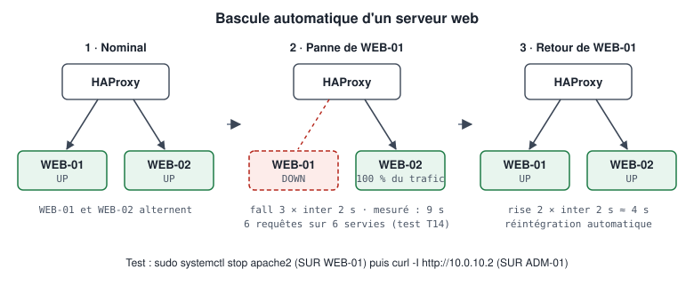

# MO-3 — WordPress sur deux serveurs web

> 📁 Document de mon dossier E6 (BTS SIO SISR), tel que je l'ai rédigé pendant la mise en place de mon laboratoire. Version du 10/10/2026. Les adresses sont celles de mon laboratoire : adapte-les au tien.

Apache, WordPress, base de données, synchronisation des fichiers et bascule.

> 🔐 Aucun mot de passe ni clé dans ce document : les secrets sont remplacés par des marque-places.

> ⚠️ **Écarts avec le labo réel** (configuration relevée le 01/10/2026, voir le DAT §7.2) :
> HAProxy contrôle ses serveurs **toutes les 2 s** (`inter 2s fall 3 rise 2`), le contrôle SQL est un simple
> test de port (`tcp-check`, pas `mysql-check`), et il n'y a **ni page de statistiques (8404) ni en-tête
> `X-Served-By`** : les passages qui les citent décrivent une cible, pas l'existant. adm-01 est le contrôleur
> de domaine Windows : les commandes notées « sur adm-01 » se jouent depuis une session du bastion Guacamole.

## Sommaire

- WordPress — Apache
- WordPress — Installation
- WordPress — Base de données
- web-01 — 10.0.10.1
- web-02 — 10.0.10.4
- WordPress — Synchronisation des fichiers
- WordPress — Failover

---

## WordPress — Apache

Configuration identique sur **web-01** et **web-02** : `configs/apache/wordpress.conf.example` (dépôt GitHub)

### Modules

**SUR web-01 et web-02**

```bash
sudo a2enmod rewrite remoteip
sudo systemctl restart apache2
apache2ctl -M | grep -E 'rewrite|remoteip|php'
```

| Module | Pourquoi |
|--------|----------|
| `rewrite` | Permaliens WordPress (`.htaccess`) |
| `remoteip` | Journaliser l'IP réelle du client au lieu de celle de HAProxy |
| `php8.2` | Exécution de WordPress (installé par `libapache2-mod-php`) |

### Points clés du vhost

| Directive | Rôle |
|-----------|------|
| `DocumentRoot /var/www/wordpress` | Racine du site |
| `AllowOverride All` | Autorise le `.htaccess` de WordPress |
| `<FilesMatch "^(wp-config\.php\|readme\.html\|license\.txt)$"> Require all denied` | Interdit l'accès direct aux fichiers sensibles ou révélant la version |
| `RemoteIPHeader X-Forwarded-For` | Lit l'IP client transmise par HAProxy |
| `RemoteIPInternalProxy 10.0.10.2` | **Seul** HAProxy est autorisé à fournir cet en-tête (sinon n'importe quel client pourrait usurper son IP) |

### IP réelle des clients dans les journaux

Sans `mod_remoteip`, chaque ligne de `/var/log/apache2/wordpress-access.log` montre `10.0.10.2` (HAProxy). Avec :

```bash
# SUR web-01
sudo tail -n 3 /var/log/apache2/wordpress-access.log
# 10.0.40.105 - - [..] "GET / HTTP/1.1" 200 ...   ← IP du poste utilisateur
# 10.0.10.2   - - [..] "GET /wp-login.php ..."   ← health-checks HAProxy
```

### Permissions

**SUR web-01 et web-02**

```bash
sudo chown -R www-data:www-data /var/www/wordpress
sudo find /var/www/wordpress -type d -exec chmod 755 {} \;
sudo find /var/www/wordpress -type f -exec chmod 644 {} \;
sudo chown root:www-data /var/www/wordpress/wp-config.php
sudo chmod 640 /var/www/wordpress/wp-config.php
```

### Vérification

```bash
sudo apachectl configtest      # Syntax OK
sudo apache2ctl -S             # vhosts actifs : wordpress.conf sur *:80
```

---

## WordPress — Installation

### Principe

```text
            ┌───────── fichiers (code, thèmes, médias) ─────────┐
            │                                                   │
      web-01 /var/www/wordpress  ── rsync ──►  web-02 /var/www/wordpress
            │                                                   │
            └──────── SQL ──► HAProxy 10.0.10.2:3306 ◄── SQL ───┘
                                     │
                         Galera (base « wordpress » unique)
```

- **Une seule base** `wordpress`, répliquée par Galera.
- **Deux copies des fichiers**, synchronisées de web-01 vers web-02.
- **Un seul `wp-config.php`**, identique sur les deux serveurs.

### 1. Base et compte SQL

**SUR bdd-01** (répliqué automatiquement)

```sql
-- sudo mariadb
CREATE DATABASE wordpress CHARACTER SET utf8mb4 COLLATE utf8mb4_unicode_ci;
CREATE USER 'wordpress'@'10.0.10.2' IDENTIFIED BY '<PASSWORD>';
GRANT ALL PRIVILEGES ON wordpress.* TO 'wordpress'@'10.0.10.2';
```

L'hôte est `10.0.10.2` car **toutes** les connexions arrivent par HAProxy. Détail : database.md.

**SUR web-01** — test de connexion via HAProxy :

```bash
mariadb -h 10.0.10.2 -P 3306 -u wordpress -p -e 'SELECT @@hostname, DATABASE();'
```

### 2. Fichiers WordPress

**SUR web-01**

```bash
sudo ./scripts/install/install-wordpress-deps.sh --apply --download
ls /var/www/wordpress    # wp-admin  wp-content  wp-includes  ...
```

### 3. wp-config.php

**SUR web-01**

```bash
sudo cp configs/wordpress/wp-config.php.example /var/www/wordpress/wp-config.php
sudo nano /var/www/wordpress/wp-config.php
```

- Remplacer `DB_PASSWORD` `<SECRET>` par le mot de passe du compte `wordpress`.
- Remplacer les 8 clés/sels `<SECRET>` par des valeurs générées sur `https://api.wordpress.org/secret-key/1.1/salt/`.
- Vérifier `DB_HOST = 10.0.10.2:3306`.

```bash
sudo chown root:www-data /var/www/wordpress/wp-config.php
sudo chmod 640 /var/www/wordpress/wp-config.php
php -l /var/www/wordpress/wp-config.php
```

Choix de configuration notables :

| Constante | Valeur | Raison |
|-----------|--------|--------|
| `DB_HOST` | `10.0.10.2:3306` | Passer par HAProxy, jamais par un nœud |
| Clés et sels | Identiques sur les 2 serveurs | Une session ouverte sur web-01 reste valide sur web-02 |
| `DISALLOW_FILE_EDIT` | `true` | Une modification via l'éditeur web n'affecterait qu'un serveur |
| `AUTOMATIC_UPDATER_DISABLED` | `true` | Une mise à jour automatique ne se ferait que sur un serveur → divergence de versions |

### 4. Assistant d'installation

**SUR adm-01** (navigateur) : `http://10.0.10.1/` (directement web-01, pour l'installation uniquement)

- Titre, compte administrateur WordPress (`<ADMIN_USER>` / `<PASSWORD>` — pas `admin`).
- Après installation, régler *Réglages → Général* : **Adresse web de WordPress** et **Adresse web du site** = l'URL par laquelle les visiteurs arrivent (ex. `http://10.0.10.2`).

### 5. Copie vers web-02

Voir web02.md puis synchronization.md.

### 6. Vérification

```bash
# SUR adm-01
./scripts/validation/check-wordpress.sh
```

Attendu : web-01 UP, web-02 UP, HAProxy UP avec alternance de `X-Served-By`.

---

## WordPress — Base de données

### Paramètres

| Élément | Valeur |
|---------|--------|
| Base | `wordpress` (utf8mb4) |
| Compte | `wordpress`@`10.0.10.2` |
| Privilèges | `ALL PRIVILEGES ON wordpress.*` (WordPress crée et modifie ses tables lors des mises à jour) |
| Point d'accès | `10.0.10.2:3306` (HAProxy) |
| Moteur | InnoDB (obligatoire pour Galera ; défaut de WordPress) |

### Création

**SUR bdd-01**

```sql
-- sudo mariadb
CREATE DATABASE wordpress CHARACTER SET utf8mb4 COLLATE utf8mb4_unicode_ci;
CREATE USER 'wordpress'@'10.0.10.2' IDENTIFIED BY '<PASSWORD>';
GRANT ALL PRIVILEGES ON wordpress.* TO 'wordpress'@'10.0.10.2';
SHOW GRANTS FOR 'wordpress'@'10.0.10.2';
```

Les comptes et privilèges (tables système InnoDB depuis MariaDB 10.4) sont répliqués : inutile de recréer le compte sur bdd-02 et bdd-03.

### Pourquoi `@'10.0.10.2'` ?

Un compte MariaDB est défini par **nom + hôte d'origine**. Les serveurs web ne se connectent pas directement aux nœuds : ils passent par HAProxy, qui ouvre lui-même la connexion vers le nœud. MariaDB voit donc l'IP **10.0.10.2**.

| Compte créé | Connexion depuis web-01 via HAProxy |
|-------------|-------------------------------------|
| `'wordpress'@'10.0.10.1'` | **Refusée** (`Access denied for user 'wordpress'@'10.0.10.2'`) |
| `'wordpress'@'10.0.10.2'` | Acceptée |
| `'wordpress'@'%'` | Acceptée, mais **trop large** (moindre privilège non respecté) |

### Vérifications

**SUR web-01**

```bash
mariadb -h 10.0.10.2 -u wordpress -p -e 'SHOW TABLES FROM wordpress;' | head
```

**SUR bdd-02**

```sql
-- Toutes les tables WordPress doivent être en InnoDB
SELECT table_name, engine FROM information_schema.tables
WHERE table_schema = 'wordpress' AND engine <> 'InnoDB';
-- attendu : aucune ligne

-- Tables sans clé primaire (à éviter avec Galera)
SELECT t.table_name FROM information_schema.tables t
LEFT JOIN information_schema.table_constraints c
  ON c.table_schema = t.table_schema AND c.table_name = t.table_name AND c.constraint_type = 'PRIMARY KEY'
WHERE t.table_schema = 'wordpress' AND c.constraint_name IS NULL;
-- attendu : aucune ligne
```

### Extensions et Galera

Certaines extensions créent des tables **MyISAM** ou **sans clé primaire**. Avant d'installer une extension, vérifier ses tables avec les requêtes ci-dessus. Une table MyISAM n'est **pas** répliquée de manière fiable par Galera.

Sauvegarde : [MO-6-Sauvegarde-restauration.md](/procedure?id=mo-06-sauvegarde)

---

## web-01 — 10.0.10.1

Premier serveur WordPress, **serveur de référence** pour les fichiers.

### Fiche

| Élément | Valeur |
|---------|--------|
| Nom de VM | web-01 |
| IP / masque | 10.0.10.1/24 |
| Passerelle | 10.0.10.254 |
| VLAN | 301 — vWEB |
| OS | Debian 12 |
| Logiciels | Apache 2.4, PHP 8.2, WordPress 6.x |
| Racine web | `/var/www/wordpress` |
| vhost | `wordpress.conf.example` (dépôt GitHub) |
| Configuration WordPress | `wp-config.php.example` (dépôt GitHub) (identique sur web-01 et web-02) |
| Base de données | `wordpress` via `10.0.10.2:3306` (HAProxy) |

### Déploiement

**SUR web-01**

```bash
# Dépendances (simulation, puis exécution)
sudo ./scripts/install/install-wordpress-deps.sh
sudo ./scripts/install/install-wordpress-deps.sh --apply
sudo ./scripts/install/install-wordpress-deps.sh --apply --download   # télécharge WordPress (SHA-1 vérifié)

# vhost Apache
sudo cp configs/apache/wordpress.conf.example /etc/apache2/sites-available/wordpress.conf
sudo a2ensite wordpress
sudo a2dissite 000-default
sudo apachectl configtest
sudo systemctl reload apache2
```

### Rôle de référence

web-01 est le **serveur de référence des fichiers** :

- l'installation WordPress (assistant web) est faite **une seule fois**, sur web-01 ;
- les extensions, thèmes, mises à jour et téléversements de médias sont effectués sur web-01 ;
- les fichiers sont ensuite copiés vers web-02 (synchronization.md).

L'installation est détaillée dans wordpress.md.

### Vérification

**SUR web-01**

```bash
systemctl is-active apache2
curl -sI http://localhost/wp-login.php | head -n 1
php -m | grep -E 'mysqli|curl|gd|mbstring|xml|zip|intl'
```

**SUR adm-01**

```bash
curl -sI http://10.0.10.1/ | head -n 1        # test T11
```

Capture attendue : `evidence/screenshots/06-wordpress-web01.png`

---

## web-02 — 10.0.10.4

Second serveur WordPress. Sert le même site que web-01, à partir d'une copie de ses fichiers.

### Fiche

| Élément | Valeur |
|---------|--------|
| Nom de VM | web-02 |
| IP / masque | 10.0.10.4/24 |
| Passerelle | 10.0.10.254 |
| VLAN | 301 — vWEB |
| OS | Debian 12 |
| Logiciels | Apache 2.4, PHP 8.2, WordPress 6.x |
| Racine web | `/var/www/wordpress` |
| vhost | `wordpress.conf.example` (dépôt GitHub) |
| Configuration WordPress | `wp-config.php.example` (dépôt GitHub) (identique sur web-01 et web-02) |
| Base de données | `wordpress` via `10.0.10.2:3306` (HAProxy) |

### Déploiement

**SUR web-02**

```bash
# Dépendances (simulation, puis exécution)
sudo ./scripts/install/install-wordpress-deps.sh
sudo ./scripts/install/install-wordpress-deps.sh --apply

# vhost Apache
sudo cp configs/apache/wordpress.conf.example /etc/apache2/sites-available/wordpress.conf
sudo a2ensite wordpress
sudo a2dissite 000-default
sudo apachectl configtest
sudo systemctl reload apache2
```

### Pas de nouvelle installation

web-02 **ne passe pas** par l'assistant d'installation WordPress : la base `wordpress` existe déjà (créée lors de l'installation sur web-01) et est partagée via Galera. web-02 reçoit seulement **une copie des fichiers** de web-01, y compris `wp-config.php`.

**SUR web-01**

```bash
sudo rsync -aAX --delete /var/www/wordpress/ <ADMIN_USER>@10.0.10.4:/tmp/wordpress-sync/
```

**SUR web-02**

```bash
sudo rsync -a --delete /tmp/wordpress-sync/ /var/www/wordpress/
sudo chown -R www-data:www-data /var/www/wordpress
sudo chown root:www-data /var/www/wordpress/wp-config.php
sudo chmod 640 /var/www/wordpress/wp-config.php
```

> Si `rsync` répond `command not found`, il manque sur **l'une des deux** machines : rsync doit être installé aux deux extrémités ([INC-04](/procedure?id=depannage)).

Procédure de synchronisation récurrente : synchronization.md

### Vérification

**SUR web-02**

```bash
systemctl is-active apache2
curl -sI http://localhost/wp-login.php | head -n 1
php -m | grep -E 'mysqli|curl|gd|mbstring|xml|zip|intl'
```

**SUR adm-01**

```bash
curl -sI http://10.0.10.4/ | head -n 1        # test T12
```

Capture attendue : `evidence/screenshots/07-wordpress-web02.png`

---

## WordPress — Synchronisation des fichiers

### Le problème

**Galera synchronise la base de données, pas les fichiers.**

| Donnée | Stockage | Synchronisée par |
|--------|----------|------------------|
| Articles, pages, utilisateurs, réglages, liste des médias | Base `wordpress` | Galera (automatique) |
| Images téléversées (`wp-content/uploads`) | Disque de chaque serveur | **Rien** par défaut |
| Thèmes, extensions (`wp-content/themes`, `plugins`) | Disque de chaque serveur | **Rien** par défaut |
| Cœur WordPress, `wp-config.php` | Disque de chaque serveur | **Rien** par défaut |

Conséquence : une image téléversée via web-01 est référencée en base (donc visible dans la médiathèque des deux serveurs) mais le **fichier** n'existe que sur web-01. Un visiteur servi par web-02 obtient une image cassée (404), une fois sur deux.

### Solution retenue (v1.0.0) : web-01 référence + rsync

1. **Toute modification de fichiers** (médias, thèmes, extensions, mises à jour) se fait sur **web-01**.
2. Les fichiers sont copiés de web-01 vers web-02 avec `rsync` (via SSH).

#### Prérequis

- `rsync` installé sur **web-01 et web-02** (le binaire distant est appelé par SSH).
- Accès SSH par clé de web-01 vers web-02 (flux F11, même VLAN).

#### Synchronisation manuelle

**SUR web-01**

```bash
# Simulation d'abord (-n) : liste ce qui serait copié ou supprimé
sudo rsync -aAXn --delete --exclude 'wp-content/cache/' \
     /var/www/wordpress/ <ADMIN_USER>@10.0.10.4:/var/www/wordpress/ \
     --rsync-path="sudo rsync"

# Puis exécution réelle
sudo rsync -aAX --delete --exclude 'wp-content/cache/' \
     /var/www/wordpress/ <ADMIN_USER>@10.0.10.4:/var/www/wordpress/ \
     --rsync-path="sudo rsync"
```

| Option | Rôle |
|--------|------|
| `-a` | Archive : récursif, conserve droits, propriétaires, dates |
| `-A -X` | Conserve ACL et attributs étendus |
| `--delete` | Supprime sur web-02 ce qui n'existe plus sur web-01 (**d'où la simulation `-n` préalable**) |
| `--rsync-path="sudo rsync"` | Écriture en root côté web-02 (nécessite une règle sudo adaptée) |
| Barre oblique finale sur la source | Copie le **contenu** du dossier, pas le dossier lui-même |

#### Synchronisation planifiée (exemple)

```bash
# SUR web-01 — /etc/cron.d/wordpress-sync (toutes les 5 minutes)
*/5 * * * * root rsync -aAX --delete --exclude 'wp-content/cache/' /var/www/wordpress/ syncuser@10.0.10.4:/var/www/wordpress/ --rsync-path="sudo rsync" >> /var/log/wordpress-sync.log 2>&1
```

Statut : **exemple**, à mettre en place et à tester avant d'être déclaré réel.

### Limites

- Un média téléversé via web-02 (si l'administrateur est servi par web-02) serait **supprimé** à la synchronisation suivante par `--delete`. D'où la persistance de session HAProxy et la règle « administration via web-01 ».
- Délai de synchronisation : un média est absent de web-02 jusqu'au prochain passage.
- Si web-01 tombe, les téléversements doivent attendre son retour (ou une bascule manuelle du rôle de référence).

### Améliorations (roadmap)

| Solution | Principe | Avantage | Inconvénient |
|----------|----------|----------|--------------|
| **NFS** | `wp-content/uploads` monté depuis un serveur NFS | Simple | Le serveur NFS devient un SPOF |
| **GlusterFS** | Volume répliqué sur web-01 et web-02 | Pas de SPOF | Plus complexe, sensible au réseau |
| **lsyncd** | rsync déclenché par inotify, quasi temps réel | Léger | Toujours unidirectionnel |
| **Stockage objet (S3/MinIO)** | Extension WordPress d'offload des médias | Évolutif | Dépendance supplémentaire |

---

## WordPress — Failover

### Comportement attendu

| Événement | Détection | Effet client | Retour |
|-----------|-----------|--------------|--------|
| Apache arrêté sur web-01 | Health-check KO ×3 (~9 s) | Aucun : requêtes rejouées sur web-02 (`redispatch`) | `rise 2` (~6 s) après redémarrage |
| VM web-02 éteinte | Health-check KO ×3 (~9 s) | Aucun : tout est servi par web-01 | Idem |
| PHP cassé sur web-01 (erreur 500) | `/wp-login.php` renvoie 500 → KO | Aucun après détection | Idem |
| Base inaccessible depuis web-01 | `/wp-login.php` en erreur → KO | Dépend : si la base est inaccessible pour les deux, le site est en erreur | — |
| web-01 **et** web-02 arrêtés | Les deux DOWN | `503 Service Unavailable` | Dès qu'un serveur revient |

<p align="center"></p>

### Démonstration rapide

**SUR adm-01** (terminal 1 — observation continue)

```bash
while true; do curl -s -o /dev/null -D - http://10.0.10.2 | grep -Ei '^HTTP/|x-served-by' | tr '\r\n' '  '; echo; sleep 1; done
```

**SUR web-01** (terminal 2)

```bash
sudo systemctl stop apache2
# observer : seules des réponses "X-Served-By: web-02"
sudo systemctl start apache2
# observer : l'alternance web-01 / web-02 reprend
```

### Procédure de test formelle

Procédure complète, dans les deux sens, avec critères de réussite : [Plan-de-tests.md](/procedure?id=plan-de-tests)

Version scriptée :

```bash
# SUR adm-01
./scripts/failover/test-web01-failure.sh --save
./scripts/failover/test-web02-failure.sh --save
```
